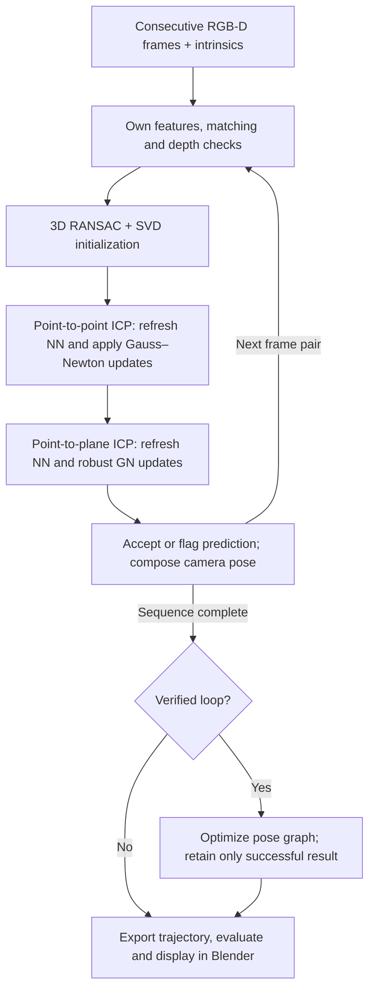

# What the current ICP code actually does

The implementation is `src/tracking/rgbd_icp.cpp`; the sequence controller is
`apps/icp_sequence.cpp`. PnP and ICP are independent trajectories. PnP does not
initialize ICP. Ground truth is opened after ICP estimation, for anchoring and
metrics only. The bunny mesh is not an estimation input.

## Implemented improvements and safeguards

| Change | Exact implementation / purpose |
| --- | --- |
| Proper rigid SVD | `rigidSVD()` applies the determinant correction to one singular axis; it never negates the whole rotation. Legacy paired-point wrappers use this exact solution. |
| Project-owned multiscale frontend | Eight levels, FAST candidates ranked with Harris response, total feature budget 1400 allocated geometrically, orientation and rotated BRIEF. |
| Conservative descriptor matching | Hamming nearest/second-nearest distances, ratio 0.87 in both directions and mutual best matches; `featurePoints()` uses `MatchMutualRatio()`. |
| Stable metric back-projection | Raw depth / 5000; reject invalid depths and 3x3 depth range >=12 mm before creating feature/cloud points. |
| Robust initialization | Three noncollinear 3D pairs per RANSAC hypothesis; 650 iterations, 9 mm inlier threshold, >=12 inliers, then repeated SVD refits. No PnP or ground-truth initializer. |
| Depth-cloud sampling | Sample every third pixel; deterministic sampling caps each cloud at 2800 points. The clouds are not limited to keypoints. |
| Target normals | Central differences of adjacent back-projected pixels; reject unstable or near-zero normals. |
| Actual iterative nearest neighbours | Exact balanced 3D KD tree, rebuilt per target cloud; nearest neighbours are refreshed every ICP iteration. |
| Distance rejection and trimming | Reject NN distances >=24 mm, retain the best 83% by distance (for sufficiently large sets), and allow at most one source per target, closest first. |
| Point-to-point updates | Damped Gauss–Newton with J=[-[x]cross, I], a six-variable normal-equation solve, left pose updates, and fixed-pair backtracking. Nearest neighbours refresh every outer iteration (up to 18). |
| Different point-to-plane objective | Minimize signed target-normal distances using rotation/translation Jacobians; up to 16 iterations. This is not a redundant repeat of fixed-pair SVD. |
| Robust and damped optimization | Huber normal-residual loss with delta 4 mm; damp the 6x6 normal equations and reject nonfinite solutions. |
| Update limits and backtracking | Each rotation-vector component is clipped to 0.1 rad and translation component to 0.03 m; try step sizes 1, 1/2, 1/4, 1/8, 1/16. Require non-increasing fixed-correspondence Huber cost. |
| Motion-change gate | Relative to each stage's initializer: at most 13 degrees rotation change and 7 cm translation change. These limits do not prove the pose is correct. |
| Explicit acceptance diagnostics | At least one update, >=70 final NN pairs and finite Euclidean NN RMSE <24 mm for both stages. Accepted and converged are separate fields. |
| Explicit failures | Flag a failed pair; use the last accepted relative motion only as a prediction, include it in trajectory error evaluation, and omit it as a measured graph edge. |
| Verified loop closures | Gap >=25 frames; candidate odometry displacement <12 cm and angle <32 degrees; check at most eight candidates. Independently register each candidate with RANSAC/ICP. Require >=35 feature inliers, ratio >=0.65, and consistency within 8 degrees /4.5 cm. |
| Robust global pose optimization | Odometry plus verified loop constraints, separate translation/rotation scales, component-wise soft-L1 loss, numerical edge Jacobians and damped updates; fix one pose per connected component. Use the graph result only when converged and cost did not increase. |
| Reliable output selection | A completed-run marker and explicit `plane`/`pose_graph` choice prevent a leftover graph file from being displayed as a new result. Blender verifies source fingerprints and pose/curve/HUD/calibration consistency. |

These changes cover algorithm quality, robustness, speed and integration; they
are not all computational speed optimizations. Residual ambiguity, local minima,
planar geometry and insufficient overlap remain possible. Loop detection is
specific to this short experiment, not a general place-recognition system.

## Simple flowchart matching the code

The point-ICP and plane-ICP boxes each contain their own iterative NN/update
loop. The NN matches in these boxes are geometric cloud matches; the BRIEF
matches in the frontend supply initialization and loop verification.

Open `outputs/00_pipeline_flowchart.png` for a standalone visual version.

## New direct comparison images

`outputs/icp/` contains PNG trajectories for SVD, RANSAC, point ICP, plane ICP
and the verified pose graph; position errors; actual iteration updates and NN
assignment changes; sampled-cloud alignment before/after; and independent PnP
pair errors before/after refinement. `iteration_history.csv` records every
performed ICP update in the sequence. Each objective before/after uses the same
pairs. The next iteration searches again; cross-iteration objectives need not
be monotonic as correspondences and rejection change.

The plane stage minimizes robust normal distance, not Euclidean NN distance.
Euclidean RMSE can increase while the normal objective and trajectory improve.
Harris responses are cached before stable sorting; selection and descriptors
are byte-identical to the uploaded version on all 36 supplied frames.
