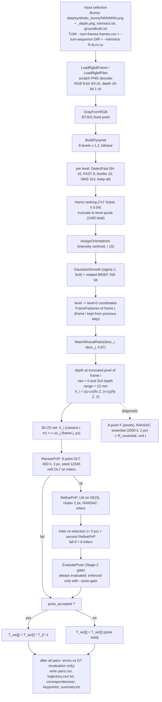

# Data flow: one RGB-D frame pair through the production pipeline

This page follows one frame pair (i, j = i+1) through `scratch_pipeline` (`apps/pipeline_main.cpp`) with the
default configuration ("T0"). Every claim is taken from the code; `path:line` points at the line that
implements it. Paths are relative to the repository root.

Scope. The production pipeline is a **frame-to-frame RGB-D visual odometry**: for each consecutive pair it
estimates one relative pose by PnP and chains the poses. It has **no map, no keyframes, no local or global
bundle adjustment, no loop closure and no relocalisation**. Nothing estimated for pair (i, j) is reused for
pair (j, j+1) except the frame-j features (`apps/pipeline_main.cpp:319-320`). The essential matrix and the
fundamental matrix are computed for every pair but are **diagnostics only**; they never influence the pose
that enters the trajectory.

## 0. Configuration that is active by default

`main` starts from `PipelineParams{}` and immediately applies `ApplyImprovedDefaults`
(`apps/pipeline_main.cpp:98-101`). The resulting T0 values:

| Parameter | T0 value | Where set | `PipelineParams{}` value (used by `--legacy`, `--stage2-frontend`) |
|---|---|---|---|
| Pyramid | 8 levels, factor 1.2 | `include/slam/features/pyramid.hpp:25-26` | same |
| FAST threshold | 10 | `src/pipeline/pipeline.cpp:41` | 20 (`include/slam/pipeline/frontend.hpp:47`) |
| FAST arc / border | 9 / 16 px | `include/slam/features/fast.hpp:16-17` | same |
| Keypoint selection | Harris ranking, total budget 1400 split over levels | `src/pipeline/pipeline.cpp:40` | FAST score, strongest 500 per level (`include/slam/features/fast.hpp:18`) |
| FAST per-cell fallback | off (`cell_size = 0`) | `include/slam/features/fast.hpp:23-24` | off (`--stage2-frontend`: 30 px / 7) |
| Matcher | `MatchMutualRatio`, ratio 0.87 | `src/pipeline/pipeline.cpp:42`, `include/slam/pipeline/frontend.hpp:37` | brute force + `max(2 d_min, 30)` filter |
| Depth scale | 5000 (raw / 5000 = metres) | `include/slam/pipeline/frontend.hpp:41` | same (no CLI flag) |
| Depth-edge rejection | 0.012 m over a 3x3 window | `src/pipeline/pipeline.cpp:43` | off (0) |
| PnP RANSAC | 650 iterations, 3 px, seed 12345 | `src/pipeline/pipeline.cpp:46-47`, `include/slam/pipeline/ransac.hpp:34` | 300 it, 8 px, seed 12345 (`include/slam/pipeline/ransac.hpp:32-34`) |
| LM refinement | on, Huber delta 2 px, max 50 iterations | `include/slam/pipeline/pipeline.hpp:38`, `src/pipeline/pipeline.cpp:44`, `include/slam/pipeline/refine.hpp:28` | on, plain least squares (delta 0) |
| Inlier re-selection | on | `src/pipeline/pipeline.cpp:45` | off (`include/slam/pipeline/pipeline.hpp:40`) |
| Stage-2 pose-validity gate | evaluated, **not enforced** | `include/slam/pipeline/pipeline.hpp:47` | same |
| Essential RANSAC (diagnostic) | 2000 it, 2 px Sampson, seed 54321 | `include/slam/pipeline/pipeline.hpp:48-51` | same |

Comment versus code: the field comments in `include/slam/pipeline/pipeline.hpp:35-37` ("FAST threshold 20,
strongest 500 ...; 300 iterations, 8 px") describe `PipelineParams{}`, not the CLI default. The values that
actually run are the ones above.

Option order matters. `--stage2-frontend` and `--legacy` replace the whole parameter set
(`src/pipeline/pipeline.cpp:51`, `apps/pipeline_main.cpp:112-113`), so any option given before them
(for example `--pose-gate`) is discarded.

## 1. Flowchart

## 2. Step by step

### 2.1 Input and dataset layout

`main` locates the repository root by walking up to `data/synthetic_bunny/intrinsics.txt`
(`include/slam/pipeline/common.hpp:73-81`, called at `apps/pipeline_main.cpp:187-194`).

**Bunny (default).** Dataset directory `data/synthetic_bunny` (`apps/pipeline_main.cpp:195`).

- Intrinsics: `intrinsics.txt` is read as `width height fx fy cx cy`; width and height are read and
  discarded (`apps/pipeline_main.cpp:201-203`). The file contains `640 480 520.9 521 325.1 249.7`.
- Ground truth: `groundtruth.txt`, TUM format `timestamp tx ty tz qx qy qz qw`, read as T_wc by
  `ReadGroundtruthTwc` (`include/slam/pipeline/common.hpp:110-125`); the timestamp is read and discarded.
- Frame k: `<dir>/%06d.png` and `<dir>/%06d_depth.png` (`src/pipeline/frontend.cpp:10-16`).
- Number of frames: N = number of ground-truth poses (36), optionally capped by `--frames`
  (`apps/pipeline_main.cpp:244-246`).

**TUM (`--tum-frames CSV --tum-sequence DIR --intrinsics fx,fy,cx,cy`, all three required,
`apps/pipeline_main.cpp:196, 205-213`).**

- The frame list is a `frames.csv` written by the reference evaluator `tum_trajectory_eval`. Columns read:
  `frame` (must be 0, 1, 2, ...), `rgb`, `depth` (paths relative to `--tum-sequence`) and
  `gt_x gt_y gt_z gt_qx gt_qy gt_qz gt_qw` (T_wc) (`apps/pipeline_main.cpp:216-230`).
- Association is **not** done by `scratch_pipeline`. It is done earlier by `tum::SelectFrames`
  (`reference/opencv_slambook2/src/dataset/tum.cpp:143-186`): RGB/depth pairs with
  |t_rgb - t_depth| <= max_dt (default 0.02 s, `reference/opencv_slambook2/tests/tum/tum_trajectory_eval.cpp:452`)
  are taken greedily by increasing |dt| (`reference/opencv_slambook2/src/dataset/tum.cpp:67-90`); the ground
  truth is interpolated at t_rgb (linear position, slerp rotation, max gap 0.05 s;
  `reference/opencv_slambook2/src/dataset/tum.cpp:96-118`). Frames without interpolable ground truth are
  dropped at that stage.
- Intrinsics come only from the command line (`apps/pipeline_main.cpp:210`). There is no distortion model
  (`include/slam/pipeline/projection.hpp:5`).
- The CSV is copied to `<out>/frames.csv` and the command line to `<out>/command.txt`
  (`apps/pipeline_main.cpp:267-273`).

### 2.2 PNG decoding

`LoadRgbdFiles` (`src/pipeline/frontend.cpp:18-40`) calls the project's own decoder `LoadPng`
(`include/slam/pipeline/png.hpp:29-33`; zlib/DEFLATE, CRC and Adler checked, filters reversed; palette and
interlaced images rejected, `include/slam/pipeline/png.hpp:5-12`).

- Out: `PngImage {width, height, channels, bit_depth, std::vector<uint16_t> samples}`, row-major,
  interleaved (`include/slam/pipeline/png.hpp:20-27`). 16-bit samples are assembled big-endian
  (`src/pipeline/png.cpp:323`).
- Checks: RGB must be 8-bit with >= 3 channels; depth must be 16-bit, 1 channel; sizes must match
  (`src/pipeline/frontend.cpp:23-38`). The Bunny files are 640x480 8-bit RGB and 640x480 16-bit grey.
- A failed load aborts the program with exit code 1 (`apps/pipeline_main.cpp:303-314`).

### 2.3 Grayscale

`ExtractFeatures` (`src/pipeline/frontend.cpp:42-70`) copies the 8-bit samples into bytes
(`src/pipeline/frontend.cpp:44-45`) and calls `features::GrayFromRGB` (`src/pipeline/frontend.cpp:47-49`).

- Formula: Y = (4899 R + 9617 G + 1868 B + 8192) >> 14 (ITU-R BT.601 in 14-bit fixed point;
  `include/slam/features/types.hpp:25-32`, `src/features/types.cpp:18, 30-31`). Alpha is ignored.
- Out: `features::GrayImage` (8-bit, row-major, `include/slam/features/types.hpp:14-23`).

### 2.4 Image pyramid

`features::BuildPyramid` (`src/features/pyramid.cpp:31-45`).

- Level 0 is the input; level l has size round(W0 / 1.2^l) x round(H0 / 1.2^l) and is resampled from level
  l-1 by centre-aligned bilinear interpolation (`src/features/pyramid.cpp:38-40`, `src/features/pyramid.cpp:9-29`).
- For 640x480: 640x480, 533x400, 444x333, 370x278, 309x231, 257x193, 214x161, 179x134.
- `scale_x[l] = W0 / W_l`, `scale_y[l] = H0 / H_l` (`src/features/pyramid.cpp:41-42`).

### 2.5 FAST detection (per level)

`features::ExtractMultiscale` (`src/features/multiscale.cpp:57-107`) runs, on every level independently,
`DetectFast` with `max_keypoints` forced to 0 (keep all) because Harris ranking / quotas are on
(`src/features/multiscale.cpp:69-72`).

`DetectFast` (`src/features/fast.cpp:39-105`):
- Segment test on the 16-pixel Bresenham circle, FAST-9, threshold 10, only for pixels at least 16 px from
  the level border (`src/features/fast.cpp:40, 47-50`).
- Score "V" = max(sum of (I(p)-I(c)-t) over brighter, sum of (I(c)-I(p)-t) over darker)
  (`src/features/fast.cpp:28-37`).
- 3x3 non-maximum suppression, ties broken by raster order (`src/features/fast.cpp:73-97`).
- Sort by (score desc, y asc, x asc) (`src/features/fast.cpp:99-103`).
- Out: `std::vector<features::Keypoint>` with integer x (column), y (row) in level pixels, `score`, `angle = 0`
  (`src/features/fast.cpp:90-95`, `include/slam/features/types.hpp:34-38`).

### 2.6 Harris ranking and the 1400-feature budget

- Quotas: `LevelQuotas(1400, 8, scale_x[1])` gives each level a share proportional to s^-l, with the
  remainder distributed by largest fractional part (`src/features/multiscale.cpp:34-56, 62-66`). For a
  640x480 image (s = 640/533) this is 304, 254, 211, 176, 146, 122, 102, 85 (sum 1400).
- Harris response on the (unsmoothed) level image at the keypoint pixel: 7x7 window of Sobel gradients
  normalised by 1020, R = det(M) - 0.04 trace(M)^2 (`src/features/multiscale.cpp:13-33`).
- Keypoints are stable-sorted by decreasing Harris response (`src/features/multiscale.cpp:73-85`) and
  truncated to the level quota (`src/features/multiscale.cpp:86-88`). A level with fewer FAST corners than its
  quota keeps them all; the unused quota is not redistributed.

### 2.7 Orientation

`AssignOrientations` on the unsmoothed level image (`src/features/multiscale.cpp:89`,
`src/features/orientation.cpp:24-26`): intensity centroid over a circular patch of radius 15,
angle = atan2(m01, m10) in radians, image axes x right / y down
(`include/slam/features/orientation.hpp:3-6, 14`, `src/features/orientation.cpp:8-21`).

### 2.8 BRIEF descriptors

`ComputeBrief(GaussianSmooth(level), kps, &valid)` (`src/features/multiscale.cpp:91-92`).

- Smoothing: separable Gaussian, sigma 2, 9x9, mirrored border (`include/slam/features/brief.hpp:23-24`,
  `src/features/brief.cpp:48-74`).
- 256 tests from a fixed pattern (seed `0x5B21EF`, Gaussian sigma 31/5, inside a disc of radius 15),
  rotated by the keypoint angle; bit i = 1 iff I(p_i) < I(q_i)
  (`include/slam/features/brief.hpp:3-11, 20-24`, `src/features/brief.cpp:23-46, 76-93`).
- Out: `features::BriefDescriptor` (4 x uint64; bit i in word i>>6, bit i&63; `include/slam/features/types.hpp:40-45`)
  plus a validity flag (false if a test leaves the image; then the descriptor is all zero).
- Mapping to the original image: x0 = (x + 0.5) * scale_x[l] - 0.5 (same for y)
  (`include/slam/features/pyramid.hpp:40-41`, `src/features/multiscale.cpp:99-100`). Level-0 keypoints keep
  integer coordinates; coarser-level keypoints get fractional coordinates.

`ExtractFeatures` packs everything into `FrameFeatures` (`include/slam/pipeline/frontend.hpp:63-75`):
`keypoints` (x, y in original-image pixels, score and angle from the level), `descriptors`,
`descriptor_valid`, `level`, `scale`, `level_x`, `level_y`, `per_level_count`
(`src/pipeline/frontend.cpp:55-68`). Features of frame i are carried over from the previous iteration
(`apps/pipeline_main.cpp:307, 315, 319-320`), so each frame is processed once.

### 2.9 Matching

`MatchFrames(fi, fj, depth_i, depth_j, K, frontend)` (`src/pipeline/frontend.cpp:72-151`), called from
`ProcessPair` (`src/pipeline/pipeline.cpp:65-66`).

In T0 (`ranked_matcher = false`, `mutual_ratio = true`):
1. `MatchBruteForce` + `FilterMatchesByDistance(..., 30)` are still run (`src/pipeline/frontend.cpp:78-80`).
   Their output only supplies `raw_matches`, `d_min` and `d_max` for `pairs.csv`.
2. `pm.filtered` is then **replaced** by `MatchMutualRatio(desc_i, desc_j, 0.87)`
   (`src/pipeline/frontend.cpp:81-83`):
   - for every descriptor, nearest and second-nearest Hamming distance in the other set; it has a candidate
     only if the other set has >= 2 descriptors and d1 < 0.87 d2 (`src/features/matcher.cpp:60-78`);
     equal distances make d2 = d1, so ties fail the test;
   - kept only if the candidate is mutual, i.e. the reverse search (with its own ratio test) returns the
     same pair (`src/features/matcher.cpp:79-84`);
   - no absolute distance limit, and `descriptor_valid` is not consulted (invalid all-zero descriptors
     take part).
- Out: `std::vector<features::Match>{query (index in i), train (index in j), distance}` in query order.

Consequence for the reported numbers: in T0, `filtered_matches` in `pairs.csv` counts the mutual-ratio
matches, while `raw_matches` and `d_min` come from the unused brute-force path.

### 2.10 Depth lookup, depth-edge rejection and back-projection

For each filtered match, one `Correspondence` (`include/slam/pipeline/frontend.hpp:81-98`) is built
(`src/pipeline/frontend.cpp:102-149`):

- `uv_i`, `uv_j`: original-image keypoint coordinates (float, pixels) (`src/pipeline/frontend.cpp:112-113`).
- `depth_raw_i`, `depth_raw_j`: raw 16-bit depth at the **truncated** pixel `(int(x), int(y))` of frame i
  and frame j (`src/pipeline/frontend.cpp:115-118`). Only the frame-i depth is used for geometry;
  `depth_raw_j` is only written to the CSV.
- `has_3d = depth_raw_i > 0` (`src/pipeline/frontend.cpp:119`).
- Depth-edge test (T0, `depth_edge_m = 0.012`): reject if the truncated pixel is on the 1-pixel image border,
  if any of the 3x3 neighbours has depth <= 0, or if max - min of the 3x3 depths (in metres, raw / 5000)
  is not < 0.012 m (`src/pipeline/frontend.cpp:120-137`).
- Back-projection, Z in metres: Z = depth_raw_i / 5000;
  X_i = ((u - cx) / fx * Z, (v - cy) / fy * Z, Z) in camera i, with (u, v) = `uv_i` (sub-pixel, not
  truncated) (`src/pipeline/frontend.cpp:138-142`).

### 2.11 Diagnostic two-view stage (does not affect the pose)

On all filtered matches (`src/pipeline/pipeline.cpp:77-99`):
- normalised coordinates x = ((u - cx)/fx, (v - cy)/fy) (`src/pipeline/pipeline.cpp:78-81`);
- `geometry_scratch::EstimateFundamental8Point` on pixels, x2^T F x1 = 0
  (`include/slam/geometry/fundamental.hpp:7-61`, `src/pipeline/pipeline.cpp:87-88`). The result is stored in
  `PairResult::F` but `scratch_pipeline` writes it nowhere;
- `RansacEssential` (8-point samples, Sampson distance x fx < 2 px, 2000 iterations, seed 54321, refit kept only
  if it loses no inliers, cheirality to choose among the four decompositions)
  (`src/pipeline/ransac.cpp:120-174`, `src/pipeline/pipeline.cpp:89-99`). Output R_essential and a unit
  translation direction, reported in `pairs.csv` and the summary.

### 2.12 3D-2D correspondence set

`ProcessPair` keeps the correspondences with `has_3d` (`src/pipeline/pipeline.cpp:102-109`):
- `X`: `std::vector<Eigen::Vector3d>`, points in camera i, metres;
- `uv`: `std::vector<Eigen::Vector2d>`, the matched frame-j pixels;
- `pnp_index`: index of each PnP input in `correspondences`.

### 2.13 RANSAC PnP

`RansacPnP(X, uv, K, {650, 3.0, 12345})` (`src/pipeline/ransac.cpp:75-118`).

- Requires n >= 6 (`src/pipeline/ransac.cpp:77-82`).
- Minimal solver: the project's **linear DLT PnP on 6 points** `solvePnPDLT`
  (`src/pipeline/ransac.cpp:77, 91`). It removes K, Hartley-normalises 2D and 3D, solves the 2n x 12 DLT
  system by SVD, fixes the sign by cheirality, projects the 3x3 block onto SO(3) and re-solves t by linear
  least squares (`src/pipeline/pnp.cpp:9-117`). It is not P3P/EPnP.
- Sampling: `std::mt19937` seeded with 12345 **for every pair** (`src/pipeline/ransac.cpp:84`), partial
  Fisher-Yates with `rng() % remaining` (`src/pipeline/ransac.cpp:11-20`). Fixed iteration count, no
  adaptive early stop (`src/pipeline/ransac.cpp:89`).
- Residual: pixel reprojection error under X_j = R X_i + t; points with Zc <= 0 get +inf
  (`src/pipeline/ransac.cpp:47-56`, `src/pipeline/projection.cpp:5-8`).
- Score: number of residuals < 3 px; ties broken by the smaller sum of inlier residuals
  (`src/pipeline/ransac.cpp:30, 33-45`).
- Failure: fewer than 6 inliers for the best model (`src/pipeline/ransac.cpp:103-106`).
- Refit: DLT on all inliers of the best model; if it fails, the best sample model is kept. The final mask
  and residuals are recomputed under the refit pose (`src/pipeline/ransac.cpp:108-117`).
- Out: `RansacPnPResult{ok, R, t, inlier_mask, residual_px, num_inliers, best_sample_inliers}`, with
  X_{i+1} = R X_i + t (`include/slam/pipeline/ransac.hpp:40-51`).

If RANSAC fails, `ProcessPair` records the reason, evaluates the gate as `solver_failed` and returns with
`pnp_ok = false`, R = I, t = 0 (`src/pipeline/pipeline.cpp:113-118`).

### 2.14 Levenberg-Marquardt refinement

`RefinePnP(X, uv, ransac_mask, K, R_lin, t_lin, {huber 2 px})` (`src/pipeline/pipeline.cpp:129-146`,
`src/pipeline/refine.cpp:42-130`).

- Cost: sum over RANSAC inliers of Huber(||pi(K(R X + t)) - uv||) with delta 2 px
  (quadratic 0.5 r^2 below delta, delta (r - 0.5 delta) above) (`src/pipeline/refine.cpp:23-38`).
- Parametrisation: left perturbation R <- Exp(phi) R, t <- Exp(phi) t + rho
  (`include/slam/pipeline/refine.hpp:9-13`, `src/pipeline/refine.cpp:96-98`); analytic 2x6 Jacobian
  (`src/pipeline/refine.cpp:69-79`); IRLS Huber weight delta / ||e|| for ||e|| > delta (`src/pipeline/refine.cpp:80-83`).
- Damping: lambda0 = 1e-3 x mean diag(J^T W J); accepted step lambda /= 3, rejected step lambda *= 4,
  at most 10 tries per iteration; stop after 50 iterations, |xi| < 1e-10, relative decrease < 1e-12, or no
  decreasing step (`include/slam/pipeline/refine.hpp:25-34`, `src/pipeline/refine.cpp:87-116`).
- R is re-orthonormalised by SVD at the end (`src/pipeline/refine.cpp:118-120`).
- `ok = false` if fewer than 3 points or a point is behind the camera at the start; then the linear pose is
  kept (`src/pipeline/refine.cpp:56-60`, `src/pipeline/pipeline.cpp:134-145`).
- On success all PnP residuals are recomputed under the refined pose (`src/pipeline/pipeline.cpp:139-144`).
  `R_linear`, `t_linear` keep the RANSAC pose for comparison (`src/pipeline/pipeline.cpp:119-120`).

### 2.15 Inlier re-selection

Only if refinement succeeded (`src/pipeline/pipeline.cpp:147`):
1. new mask = residual < 3 px under the refined pose (`src/pipeline/pipeline.cpp:148-149`);
2. a second `RefinePnP` from the refined pose on the new mask; its pose is used only if it succeeds
   (`src/pipeline/pipeline.cpp:150-156`);
3. residuals and mask recomputed; `pnp_inliers` = new count (`src/pipeline/pipeline.cpp:157-164`);
4. fewer than 6 inliers -> `pnp_ok = false`, reason "Insufficient refined support"
   (`src/pipeline/pipeline.cpp:165-168`).

Inlier statistics (mean / median / max over the final mask, median over all finite residuals) follow
(`src/pipeline/pipeline.cpp:170-176`).

### 2.16 Stage-2 pose-validity gate (off by default)

`EvaluatePose` is **always** run on the final pose and mask (`src/pipeline/pipeline.cpp:180-190`,
`src/pipeline/validity.cpp:69-137`). It sees only R, t and the correspondences (`include/slam/pipeline/validity.hpp:3-5`).
Default criteria (`include/slam/pipeline/validity.hpp:34-46`): finite R, t; ||R^T R - I||_F and |det R - 1|
<= 1e-6; >= 20 inlier rows; >= 20 distinct inlier keypoints in each frame; >= 20 distinct inlier locations
(2 px single linkage) in each frame; inlier ratio >= 0 (recorded only); >= 7 occupied 40x40 px cells in each
frame; inlier residual median <= 0.5 x threshold and 90th percentile <= 1.0 x threshold (threshold = the
RANSAC threshold, 3 px in T0).

`pose_accepted = pnp_ok && (!gate_enabled || validity.accepted())` (`src/pipeline/pipeline.cpp:191`).
With the default (`validity.enabled = false`, `include/slam/pipeline/pipeline.hpp:47`) every solved pair is
accepted. With `--pose-gate` (`apps/pipeline_main.cpp:168-169`) a rejected pair is treated like a failed
one: the previous pose is held, and `pose_validity.csv` is written.

Why it is off: the reprojection criteria (median ≤ 0.5 × threshold) were derived at the former 8 px RANSAC
threshold. At 3 px they rejected 36 of 495 TUM stride-4 poses, 33 of them good, and 16 full-sequence poses,
and made ATE worse in every case (`docs/components/pipeline.md`, "Production defaults (T0) and why"). They,
and the 20-location bound, must be re-derived for 3 px, without ground truth, before the gate is enabled.

### 2.17 Trajectory accumulation

After all pairs (`apps/pipeline_main.cpp:326-337`), each pair becomes a `RelativeStep{accepted, T = (R, t)}`
and `AccumulateTrajectory(Twc_gt[0], steps)` (`include/slam/pipeline/accumulate.hpp:39-55`) computes

- T_wc[0] = T_gt[0] (source `gt_anchor`) (`include/slam/pipeline/accumulate.hpp:44-45`);
- accepted pair: T_wc[k+1] = T_wc[k] * (T_{k+1<-k})^-1 (`include/slam/pipeline/accumulate.hpp:48`);
- otherwise T_wc[k+1] = T_wc[k], source `held_previous_pose_pair_failed` or
  `held_previous_pose_pair_rejected` (`include/slam/pipeline/accumulate.hpp:50-51`, `apps/pipeline_main.cpp:331`).

There is no motion model, no interpolation over failures and no re-optimisation of earlier poses.

### 2.18 Output files

Default directory `results/runs/pipeline/` under the repository root; `--out DIR` overrides it
(relative paths are taken from the repository root) (`apps/pipeline_main.cpp:262-266`).

| File | Content | Written at |
|---|---|---|
| `keypoints/frame_%06d.csv` | `index,x,y,score,angle_deg,level,scale,level_x,level_y,descriptor_hex`; x, y in original pixels; descriptor as 4 x 16 hex digits, word 0 first, each word most significant digit first | `apps/pipeline_main.cpp:274-298` |
| `pairs.csv` | one row per pair: counts, `pnp_ok` (**= pose_accepted**), inliers, reprojection statistics, errors vs GT, t and R of T_{j<-i} (`tx..tz`, `r00..r22`), essential diagnostics, linear-pose errors, refinement RMS | `apps/pipeline_main.cpp:369-408` |
| `correspondences/pair_<i>_<j>.csv` | every filtered match: indices, Hamming, levels, `u_i,v_i,u_j,v_j`, raw depths, `X_i,Y_i,Z_i` (m, empty without 3D), essential inlier flag, `pnp_used`, `pnp_inlier`, `pnp_residual_px`; four extra columns with the ranked matcher | `apps/pipeline_main.cpp:409-438` |
| `trajectory.csv` | 5 `#` lines (configuration, convention, accumulation rule), then `frame,tx,ty,tz,r00..r22,qx,qy,qz,qw,rotation_error_deg,translation_error_m,pnp_inliers,pose_source` (T_wc) | `apps/pipeline_main.cpp:441-484` |
| `trajectory.txt` | TUM-style `timestamp tx ty tz qx qy qz qw` (T_wc); the timestamp column is the **frame index** | `apps/pipeline_main.cpp:470-487` |
| `summary.txt` | the summary also printed to stdout | `apps/pipeline_main.cpp:570-656` |
| `frames.csv`, `command.txt` | TUM runs only | `apps/pipeline_main.cpp:267-273` |
| `matcher.csv`, `matches/pair_<i>_<j>.csv` | `--ranked-matcher` family only (`matches/` also needs `--export-match-details`) | `apps/pipeline_main.cpp:491-516` |
| `pose_validity.csv` | `--pose-gate` only | `apps/pipeline_main.cpp:518-539` |

The exit code is 1 only if every pair failed (`apps/pipeline_main.cpp:664`).

## 3. Data types along the path

| Stage | Type | Units / frame |
|---|---|---|
| decoded image | `scratch::PngImage` (uint16 samples) | 8-bit RGB values; raw 16-bit depth |
| grey / pyramid | `features::GrayImage`, `features::ImagePyramid` | 8-bit intensity |
| keypoint | `features::Keypoint` / `MultiscaleKeypoint` | pixels (level and level-0), radians |
| descriptor | `features::BriefDescriptor` | 256 bits |
| match | `features::Match` | indices, Hamming distance 0..256 |
| correspondence | `scratch::Correspondence` | pixels; raw depth; X_i in metres, camera i |
| pose | `Eigen::Matrix3d R`, `Eigen::Vector3d t` | T_{j<-i}, metres |
| trajectory | `scratch::Pose` (`include/slam/pipeline/common.hpp:27-30`) | T_wc, metres |

## 4. What differs under `--stage2-frontend` (M0) and T0-ransac

**M0, `--stage2-frontend`** = `PipelineParams{}` plus the FAST per-cell fallback
(`src/pipeline/pipeline.cpp:50-54`):

| Step | T0 | M0 |
|---|---|---|
| FAST | threshold 10, keep all candidates | threshold 20 (`include/slam/pipeline/frontend.hpp:47`); cells of 30 px with no corner are searched again at 7 (`src/features/fast.cpp:54-71`) |
| Selection | Harris, 1400 total by quota | FAST-score order, strongest 500 per level (`src/features/multiscale.cpp:86-88`, `include/slam/features/fast.hpp:18`) |
| Matching | `MatchMutualRatio` 0.87 | brute-force nearest neighbour, keep distance <= max(2 d_min, 30) (`src/features/matcher.cpp:35-53`) |
| 3D validity | depth > 0 and 3x3 range < 12 mm | depth > 0 only |
| RANSAC PnP | 650 it, 3 px | 300 it, 8 px |
| LM | Huber 2 px | least squares |
| Inlier re-selection | on | off |
| Gate | off | off (`--pose-gate` must come after `--stage2-frontend`) |

`--legacy` is `PipelineParams{}` without the FAST fallback (`apps/pipeline_main.cpp:112-113`).

**T0-ransac** = T0 with `--pnp-iterations 300 --pnp-threshold 8` (`apps/pipeline_main.cpp:124-127`). The
threshold is used in three places, so all three change: RANSAC inlier test, inlier re-selection
(`src/pipeline/pipeline.cpp:149, 162`), and the gate's reprojection limits (4 px median, 8 px p90)
(`src/pipeline/validity.cpp:129-132`).

## 5. Where ground truth is used

`ProcessPair` has no ground-truth argument (`include/slam/pipeline/pipeline.hpp:116-119`), and the gate is
explicitly ground-truth-free (`include/slam/pipeline/validity.hpp:3-5`). Nothing in feature extraction,
matching, PnP, refinement, re-selection or the gate reads ground truth. Ground truth is nevertheless read
by `scratch_pipeline` in three places, and only the last one is pure evaluation. (`ProcessPair` is called
with features, frames, K and params only, `apps/pipeline_main.cpp:317-318`.)

1. **Sequence length.** N = number of ground-truth poses (`apps/pipeline_main.cpp:244`). In TUM mode, the
   frame list itself was filtered upstream to frames with interpolable ground truth
   (`reference/opencv_slambook2/src/dataset/tum.cpp:171-175`).
2. **Anchor / world frame.** T_wc[0] = T_gt[0] (`apps/pipeline_main.cpp:335`). This fixes the world frame
   and the first pose; it does not change any relative motion.
3. **Evaluation,** computed after all decisions (`apps/pipeline_main.cpp:339-366`): per-pair errors against
   G = T_gt[k+1]^-1 T_gt[k], absolute per-frame errors, and the error columns of `pairs.csv`,
   `trajectory.csv`, `pose_validity.csv` and `summary.txt`.

So the statement "ground truth is used only for evaluation" holds for the estimation of every relative pose.
The trajectory is, however, expressed in the ground-truth world frame through the frame-0 anchor, and the
frame count comes from the ground-truth file.
