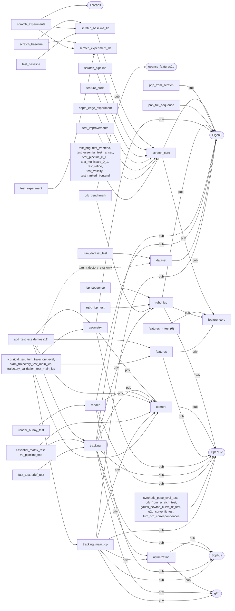

# Module reference

One section per CMake library/executable group, as defined in the root `CMakeLists.txt`, `cmake/*.cmake`,
`reference/opencv_slambook2/CMakeLists.txt`, `reference/icp_main_variant/CMakeLists.txt`,
`experiments/rgbd_icp/CMakeLists.txt` and `experiments/rgbd_icp/icp_cpp/CMakeLists.txt`, followed by the
dependency graph and the layering rules. Paths are relative to the repository root. For the overall picture
see `SYSTEM_OVERVIEW.md`.

Conventions used throughout production code:

* Relative pose T_{j<-i}: X_j = R X_i + t (`include/slam/pipeline/pipeline.hpp:18`,
  `include/slam/pipeline/essential.hpp:7-11`).
* Absolute pose T_wc: camera -> world, TUM order `tx ty tz qx qy qz qw`
  (`include/slam/pipeline/common.hpp:110`).
* Pinhole intrinsics without distortion (`include/slam/pipeline/projection.hpp:6`).

---

## 1. `feature_core` (production)

* **Defined in:** `cmake/feature_core.cmake:7-15` (single definition, included by the root `CMakeLists.txt:23`
  and by `experiments/rgbd_icp/icp_cpp/CMakeLists.txt:14`).
* **Responsibility:** project-owned feature extraction and matching: grayscale conversion, image pyramid,
  FAST, intensity-centroid orientation, Gaussian-smoothed rotated BRIEF, Hamming matching (three matchers),
  multiscale extraction with optional Harris ranking and feature budget. Deterministic.
* **Public headers** (include root `include/slam`, so code writes `#include "features/fast.hpp"`):
  `features/types.hpp`, `fast.hpp`, `orientation.hpp`, `brief.hpp`, `matcher.hpp`, `pyramid.hpp`,
  `multiscale.hpp`.
* **Main types / functions** (namespace `features`):
  * `GrayImage`, `Keypoint`, `BriefDescriptor` (256 bits), `Match`; `GrayFromRGB`, `GrayFromInterleaved`
    (BT.601, 14-bit fixed point) — `types.hpp`.
  * `FastParams` (threshold 30, arc 9, border 16, max 500, per-cell fallback off; `fast.hpp:15-24`),
    `IsFastCorner`, `FastScore`, `DetectFast`.
  * `IntensityCentroidAngle`, `AssignOrientations` (radius 15).
  * `BriefPattern`, `GaussianSmooth` (sigma 2, 9x9), `ComputeBriefDescriptor`, `ComputeBrief`,
    `HammingDistance`.
  * `MatchBruteForce`, `FilterMatchesByDistance` (`max(2 d_min, floor)`), `MatchMutualRatio` (default 0.87,
    `matcher.hpp:28`), `MatchRanked` + `MatcherParams`/`RankedMatch`/`MatchCounters`/`MatchSet`/`QualityBefore`
    (Stage 3, `matcher.hpp:63-117`).
  * `PyramidParams` (8 levels x 1.2), `BuildPyramid`, `ResizeBilinear`, `LevelToBaseX/Y`.
  * `SelectionParams` (`harris`, `total_features`), `HarrisResponse`, `LevelQuotas`, `ExtractMultiscale`
    (`multiscale.hpp`).
* **Dependencies:** none (C++ standard library only); no `target_link_libraries`. Publishes include
  directory `include/slam` (PUBLIC).
* **Dependants:** `scratch_core`, the six `features_*_test`, reference `features` (PRIVATE), `rgbd_icp`
  (PUBLIC), transitively everything above them.
* **Tests:** `tests/unit/features_fast_test.cpp`, `features_orientation_test.cpp`, `features_brief_test.cpp`,
  `features_matcher_test.cpp`, `features_pyramid_test.cpp`, `features_matcher_ranked_test.cpp`
  (+ `feature_test_utils.hpp`); registered at `CMakeLists.txt:81-86`.
* **Status:** production.

## 2. `geometry/fundamental.hpp` (production, header-only, no target)

* **File:** `include/slam/geometry/fundamental.hpp`.
* **Responsibility:** `geometry_scratch::EstimateFundamental8Point` — normalised 8-point fundamental matrix in
  pixel coordinates (Hartley normalisation, rank-2 projection, unit Frobenius norm). Eigen only.
* **Used by:** `src/pipeline/pipeline.cpp:2,87-88` (diagnostic `PairResult::F`), reference
  `reference/opencv_slambook2/src/geometry/geometry.cpp:2`, `tests/pipeline/test_improvements.cpp`.
* **Include path:** reached through `feature_core`'s PUBLIC `include/slam` in production, and through an
  explicit PRIVATE include in reference `geometry` (`reference/opencv_slambook2/CMakeLists.txt:36`).
* **Status:** production.

## 3. `scratch_core` (production)

* **Defined in:** `CMakeLists.txt:27-32`. Sources: `src/pipeline/{png,frontend,projection,pnp,essential,ransac,refine,validity,pipeline}.cpp`.
* **Responsibility:** the complete per-pair estimator: PNG decoding, RGB-D frame loading, front end
  (features, matching, depth association), linear PnP, essential matrix, RANSAC, LM refinement, pose-validity
  gate, `ProcessPair`; plus header-only helpers for poses, CSV, ground-truth reading and trajectory accumulation.
* **Public headers** (include dir `include/slam/pipeline`, included by bare name, e.g. `"pipeline.hpp"`):
  * `png.hpp` — `scratch::PngImage`, `DecodePng`, `LoadPng`, `Inflate`, `ZlibDecompress`, `Crc32`, `Adler32`.
  * `projection.hpp` — global `Intrinsics`, `projectPoint`.
  * `pnp.hpp` — global `PnPResult`, `solvePnPDLT` (DLT, n >= 6).
  * `essential.hpp` — `scratch::EstimateEssential8Point`, `EnforceEssentialConstraints`, `DecomposeEssential`,
    `TriangulateDepths`, `CountInFront`, `RecoverPoseFromEssential`, `SampsonDistance`,
    `FundamentalFromEssential`, `EpipolarLine`, `EpipolarDistance`.
  * `ransac.hpp` — `RansacParams` (300 it, 8 px, seed 12345; `ransac.hpp:32-34`), `SampleIndices`,
    `RansacPnP`, `RansacEssential` (deterministic `std::mt19937` + partial Fisher-Yates).
  * `refine.hpp` — `RefineParams` (`huber_delta_px` 0, 50 iterations; `refine.hpp:26-28`), `RefinePnP`
    (LM on SE(3), left perturbation), `ExpSO3`.
  * `validity.hpp` — `ValidityParams` (`enabled` true at struct level, `validity.hpp:35`, but set false by
    `PipelineParams`), `ValidityRow`, `PoseStatus`, `PoseValidity`, `EvaluatePose`, helper counters.
  * `frontend.hpp` — `FrontendParams`, `RgbdFrame`, `LoadRgbdFrame`, `LoadRgbdFiles`, `FrameFeatures`,
    `ExtractFeatures`, `Correspondence`, `PairMatches`, `MatchFrames`.
  * `pipeline.hpp` — `PipelineParams`, `PairResult`, `ApplyImprovedDefaults` (T0), `ApplyStage2Frontend` (M0),
    `ProcessPair`.
  * `common.hpp` (header-only) — `Pose`, `QuatToR`, `RToQuat`, `RotErrDeg`, `FindRepo`/`IsRepoRoot`, `Csv`,
    `ReadGroundtruthTwc`, `Reprojection`.
  * `accumulate.hpp` (header-only) — `Inverse`, `Compose`, `RelativeStep`, `AccumulatedTrajectory`,
    `AccumulateTrajectory`.
* **Dependencies:** link `Eigen3::Eigen`, `feature_core` (both PUBLIC, `CMakeLists.txt:31`); include
  `include/slam/pipeline` (PUBLIC) and, transitively from `feature_core`, `include/slam`.
* **Dependants:** `scratch_pipeline`, `depth_edge_experiment`, `feature_audit`, `scratch_baseline_lib`,
  `scratch_experiment_lib`, the nine `tests/pipeline` tests built in the loop, `test_improvements`.
  `pnp_from_scratch` and `pnp_full_sequence` do not link it but compile `pnp.cpp` and `projection.cpp` and use
  its include directory (`CMakeLists.txt:35-44`).
* **Tests:** `tests/pipeline/test_png.cpp`, `test_frontend.cpp`, `test_essential.cpp`, `test_ransac.cpp`,
  `test_pipeline_0_1.cpp`, `test_multiscale_0_1.cpp`, `test_refine.cpp`, `test_validity.cpp` (also covers
  `accumulate.hpp`), `test_ranked_frontend.cpp` (`CMakeLists.txt:87-93`); `test_improvements.cpp`
  (`CMakeLists.txt:120-122`); the milestone tests (`CMakeLists.txt:95-99`).
* **Status:** production.

## 4. `scratch_baseline_lib` (evaluation)

* **Defined in:** `CMakeLists.txt:59-62`. Source `src/evaluation/baseline.cpp`.
* **Responsibility:** Stage-1 measurement / regression harness: loads fixture pairs, runs `ExtractFeatures` +
  `ProcessPair`, measures every stage, scores against ground truth afterwards, compares with locked values,
  multi-seed sweeps, raw ATE of an existing run. Ground truth is held in a separate `FixtureGroundTruth`
  list and never passed to `MeasureFixture` (`include/slam/evaluation/baseline.hpp:14-17`).
* **Public header:** `include/slam/evaluation/baseline.hpp` (namespace `scratch::baseline`): `Fixture`,
  `FixtureGroundTruth`, `LoadFixtures`, `CountDistinct`, `CountDistinctLocations`,
  `CountCrossLevelNearDuplicates`, `PairMeasurement`, `Measure`, `MeasureFixture`, `RelativeGroundTruth`,
  `ScoreMeasurement`, `NumericFields`, `GateFields`, `FieldTolerance`, `LoadExpected`, `Compare`,
  `CompareGate`, `CheckAgainstExport`, `ToJson`, `DefaultSeedSweep`, `ParseSeedList`, `SweepFixture`,
  `SummarizeSweep`, `RawAte`.
* **Dependencies:** link `scratch_core` (PUBLIC); include `include/slam/evaluation` (PUBLIC).
* **Dependants:** `scratch_baseline`, `scratch_experiments`, `test_baseline`.
* **Tests:** `tests/pipeline/test_baseline.cpp` (`CMakeLists.txt:100-103`); the lock test
  `scratch_baseline_lock` against `tests/fixtures/baseline_expected*.csv` (`CMakeLists.txt:110-112`; exit 77 =
  TUM images absent -> skipped).
* **Status:** evaluation (not in the per-frame pipeline).

## 5. `scratch_experiment_lib` (evaluation)

* **Defined in:** `CMakeLists.txt:63-66`. Source `src/evaluation/experiment.cpp`.
* **Responsibility:** Stage-3C and integration experiments: matcher presets, named complete pipeline
  configurations, a step-by-step RANSAC trace that must reproduce `RansacPnP` exactly, offline gate
  diagnostics, and one ground-truth evaluation function.
* **Public header:** `include/slam/evaluation/experiment.hpp` (namespace `scratch::experiment`):
  `MatcherConfigIds`, `ApplyMatcherConfig`, `DescribeMatcherConfig`, `IntegrationConfigIds`,
  `ApplyIntegrationConfig` (M0..M3L, L0, T0, T0G, T0R, T0M, T0Q, T0GR, T0E, T0H, T0-harris, T0-budget,
  T0-fast20, T0-mr, T0-reselect, T0-ransac, T0C, T0CG; `src/evaluation/experiment.cpp:91-150`),
  `RansacTrace`, `TraceRansacPnP`, `TraceMatches`, `GateDiagnostics`, `DiagnoseGate`,
  `CovarianceEigenvalues`, `CountLocationPairGroups`, `TruthEval`, `EvaluateWithTruth`.
* **Dependencies:** link `scratch_core` (PUBLIC); include `include/slam/evaluation` (PUBLIC). It includes
  `pnp.hpp`, `ransac.hpp` directly (`src/evaluation/experiment.cpp:11-13`).
* **Dependants:** `scratch_baseline` (uses `ApplyIntegrationConfig`/`ApplyMatcherConfig`,
  `apps/baseline_main.cpp:77,88`), `scratch_experiments`, `test_experiment`.
* **Tests:** `tests/pipeline/test_experiment.cpp` (`CMakeLists.txt:104-107`).
* **Status:** evaluation.

## 6. Production applications (`apps/`)

| Target | Source | Links | Role | Tests |
|---|---|---|---|---|
| `scratch_pipeline` | `apps/pipeline_main.cpp` | `scratch_core` (`CMakeLists.txt:47-49`) | **the production application**: Bunny or TUM RGB-D in, T_wc trajectory + per-pair diagnostics out; T0 defaults (`apps/pipeline_main.cpp:101`) | `milestone3_scratch_pipeline` (`CMakeLists.txt:98`) |
| `scratch_baseline` | `apps/baseline_main.cpp` | `scratch_baseline_lib`, `scratch_experiment_lib` | fixture lock comparison, multi-seed sweeps, raw ATE; default config = main's Stage-2 + gate (`apps/baseline_main.cpp:48-52`) | `scratch_baseline_lock` |
| `scratch_experiments` | `apps/experiments_main.cpp` | `scratch_experiment_lib`, `scratch_baseline_lib`, `Threads::Threads` | runs named configurations over fixtures or a TUM sequence, one thread per configuration; writes `runs.csv`, `matchsets.csv`, `ate.csv` | none |
| `feature_audit` | `apps/feature_audit.cpp` | `scratch_core` | front-end audit of one Bunny pair; cross-checks its own ratio/mutual decisions against `MatchMutualRatio` | `feature_audit_pair_0_1` (`CMakeLists.txt:127`) |
| `pnp_from_scratch` | `apps/milestones/main.cpp` + `src/pipeline/pnp.cpp`, `projection.cpp` | `Eigen3::Eigen` | milestone 1: DLT PnP on pair 0->1 from frozen reference correspondences | `milestone1_pnp_from_scratch` |
| `pnp_full_sequence` | `apps/milestones/sequence_main.cpp` + same two sources | `Eigen3::Eigen` | milestone 2: DLT PnP on all 35 pairs, no RANSAC | `milestone2_pnp_full_sequence` |
| `depth_edge_experiment` | `experiments/depth_edge/depth_edge_experiment.cpp` | `scratch_core` (`CMakeLists.txt:53-55`) | read-only experiment: geometric stage with and without depth-edge correspondences (its own edge rule, not the T0 12 mm rule) | none |

Status: production (`scratch_pipeline`), evaluation (`scratch_baseline`, `scratch_experiments`), diagnostic
(`feature_audit`), history (milestones), experiment (`depth_edge_experiment`).

## 7. Reference libraries (`reference/opencv_slambook2/`, OpenCV build only)

All are built only with `-DSLAM_WITH_OPENCV=ON` (`CMakeLists.txt:130-134`). The directory needs OpenCV, Eigen3,
g2o and Sophus (`reference/opencv_slambook2/CMakeLists.txt:8-11`). Public include root:
`reference/opencv_slambook2/include`. None of the demos is registered with CTest.

### 7.1 `camera`
* `CMakeLists.txt:17-19` (reference). Header `camera/camera.hpp`: `PinholeCamera` (with `K()` as `cv::Mat`),
  `pixel2cam`, `cam2pixel` (book code).
* Links: OpenCV (PUBLIC). Dependants: `geometry` (PRIVATE), `tracking` (PRIVATE), `render` (PUBLIC),
  `tracking_main_icp` (PRIVATE), all `add_test_exe` and main-ICP executables, `essential_matrix_test`,
  `vo_pipeline_test`.

### 7.2 `features` (reference)
* `CMakeLists.txt:25-27`. Header `features/features.hpp`: `find_feature_matches(img1, img2, kp1, kp2,
  matches, all_matches*)` with the book's signature and `max(2 d_min, 30)` filter; implemented with
  `feature_core` (single-scale FAST 30 / 500, rotated BRIEF, brute-force Hamming;
  `reference/opencv_slambook2/src/features/features.cpp:12-17`), converting to/from `cv::KeyPoint`/`cv::DMatch`.
* Links: OpenCV (PUBLIC), `feature_core` (PRIVATE). Dependants: all `add_test_exe` demos and the main-ICP
  executables.

### 7.3 `geometry`
* `CMakeLists.txt:32-36`. Header `geometry/geometry.hpp`: `pose_estimation_2d2d` (book code; the
  fundamental matrix comes from the production `geometry_scratch::EstimateFundamental8Point`,
  `reference/opencv_slambook2/src/geometry/geometry.cpp:35`, the essential matrix and pose from OpenCV `findEssentialMat`/`recoverPose`,
  `geometry.cpp:47,54`), `triangulation` (`cv::triangulatePoints`, `geometry.cpp:79`).
* Links: OpenCV (PUBLIC); `camera`, Eigen (PRIVATE); PRIVATE include `include/slam` for
  `geometry/fundamental.hpp`.
* Dependants: `add_test_exe` demos, main-ICP executables.

### 7.4 `optimization`
* `CMakeLists.txt:39-41`, INTERFACE library. Header `optimization/g2o_types.hpp`: `VertexPose`
  (`g2o::BaseVertex<6, Sophus::SE3d>`).
* Links: `g2o::core`, `Sophus::Sophus` (INTERFACE). Dependants: `tracking`, `tracking_main_icp` (PRIVATE).

### 7.5 `tracking` (teammate's ICP variant)
* `CMakeLists.txt:47-60`. Sources `reference/opencv_slambook2/src/tracking/{pnp,icp,essential_matrix,fast,brief,hamming_matching}.cpp`;
  compiled with `-msse4`.
* Headers `tracking/pnp.hpp` (`bundleAdjustmentGaussNewton`, `bundleAdjustmentG2O`, book code),
  `tracking/icp.hpp` (`pose_estimation_3d3d`, `bundleAdjustment` — here a wrapper around `rgbd_icp::rigidSVD`
  without g2o, `reference/opencv_slambook2/src/tracking/icp.cpp:8-33`), `tracking/essential_matrix.hpp`
  (`EstimateRelativePoseEssentialMatrix`, `RecoverPoseFromEssential`, OpenCV types), `tracking/fast.hpp`,
  `tracking/brief.hpp`, `tracking/hamming_matching.hpp` (a separate, older single-scale from-scratch
  FAST/BRIEF/Hamming on `cv::Mat`, unrelated to `feature_core`).
* Links: OpenCV, Eigen, Sophus (PUBLIC); `optimization`, `g2o::core`, `g2o::stuff`, `g2o::solver_dense`,
  `camera`, **`rgbd_icp`** (PRIVATE).
* Dependants: 11 `add_test_exe` demos (`feature_matching_test`, `two_view_pose_test`, `triangulation_test`,
  `pnp_test`, `icp_test` in `reference/opencv_slambook2/tests/integration`; `pnp_synthetic_test`, `pnp_multiframe_test`,
  `icp_synthetic_test`, `slam_trajectory_test`, `trajectory_validation_test`, `trajectory_diagnostics_test` in
  `reference/opencv_slambook2/tests/synthetic`), `essential_matrix_test`, `fast_test`, `brief_test`, `vo_pipeline_test`.

### 7.6 `render`
* `CMakeLists.txt:67-74`. Headers `render/mesh.hpp` (`Mesh`, `ComputeFaceNormals`, `Aabb`),
  `render/ply_mesh_io.hpp` (`ReadPLYMesh`, `WritePLYMesh`), `render/rasterizer.hpp` (CPU rasteriser,
  `DepthMetersToTUM16U`), `render/trajectory.hpp` (`OrbitTrajectoryParams`, `GenerateOrbitTrajectory`),
  `render/visualization.hpp` (PLY trajectory / frustum geometry).
* Links: OpenCV, Eigen, Sophus, `camera` (all PUBLIC). Dependant: `render_bunny_test` (the synthetic Bunny
  data generator).

### 7.7 `dataset`
* `CMakeLists.txt:141-143`. Header `dataset/tum.hpp` (namespace `tum`): `Stamped`, `GtSample`, `Pose`,
  `ReadFileList`, `ReadGroundtruth`, `Associate`, `QuaternionToR`, `InterpolateGroundtruth`,
  `CameraIntrinsics`, `OfficialIntrinsics`, `Frame`, `SelectionReport`, `SelectFrames`.
* Links: Eigen (PUBLIC); no OpenCV in the target, but it is only built in the OpenCV configuration.
* Dependants: `tum_dataset_test`, `tum_trajectory_eval`.

### 7.8 Stand-alone reference executables
`render_bunny_test`, `synthetic_pose_eval_test`, `orb_from_scratch_test`, `gauss_newton_curve_fit_test`,
`g2o_curve_fit_test`, `essential_matrix_test`, `fast_test`, `brief_test`, `vo_pipeline_test`,
`tum_dataset_test`, `tum_orb_correspondences` (`reference/opencv_slambook2/CMakeLists.txt:76-143`).
Status of the whole directory: **reference** (comparison only, not production).

## 8. `tracking_main_icp` and its consumers (`reference/icp_main_variant/`)

* **Defined in:** `reference/icp_main_variant/CMakeLists.txt:13-25`, added from
  `reference/opencv_slambook2/CMakeLists.txt:147-150` when `BUILD_MAIN_ICP_VARIANT` (default ON).
* **Responsibility:** main's ICP preserved verbatim: the same sources as `tracking` except `icp.cpp`, which
  is main's — book SVD `pose_estimation_3d3d`, g2o `bundleAdjustment` (`src/icp.cpp:66-101`), plus
  `FitRigid` and `EstimateRigidRansac` (`reference/icp_main_variant/include/tracking/icp.hpp:30-44`; RANSAC over 3-point rigid fits,
  default 1 cm, 300 iterations, seed 12345).
* **Headers:** `reference/icp_main_variant/include/tracking/icp.hpp`, placed BEFORE the reference include path
  (`CMakeLists.txt:21`), plus every other `tracking/*.hpp` from `reference/opencv_slambook2/include`.
* **Links:** OpenCV, Eigen, Sophus (PUBLIC); `optimization`, g2o core/stuff/solver_dense, `camera` (PRIVATE).
  No `rgbd_icp`.
* **Executables** (`add_main_icp_exe`, `CMakeLists.txt:28-44`, each linking `camera features geometry
  tracking_main_icp`): `icp_rigid_test`, `tum_trajectory_eval` (+ `dataset`; the OpenCV TUM evaluator:
  `find_feature_matches` -> `solvePnPRansac(100, 8 px, 0.99)` and ICP via `EstimateRigidRansac` +
  `bundleAdjustment`, `reference/opencv_slambook2/tests/tum/tum_trajectory_eval.cpp:5-8`),
  `slam_trajectory_test_main_icp`, `trajectory_validation_test_main_icp`.
* **Dependants (data):** the Python tooling under `tools/evaluation/` and the TUM Blender scenes read
  `tum_trajectory_eval` outputs; `scratch_pipeline --tum-frames` reads its `frames.csv`.
* **Tests:** the executables above are self-checking programs; none is registered with CTest.
* **Status:** reference; one of two retained ICP variants (no final decision).

## 9. `rgbd_icp` (`experiments/rgbd_icp/`)

* **Defined in:** `experiments/rgbd_icp/CMakeLists.txt:6-13` (root OpenCV build) and
  `experiments/rgbd_icp/icp_cpp/CMakeLists.txt:15-25` (standalone).
* **Responsibility:** the teammate's dense RGB-D registration: feature-based 3D-3D RANSAC initialisation
  using `feature_core`, point-to-point and point-to-plane ICP (Gauss-Newton with Huber and trimming), loop
  candidate search and pose-graph optimisation.
* **Public header:** `experiments/rgbd_icp/include/tracking/rgbd_icp.hpp` (namespace `rgbd_icp`): `Pose`,
  `Camera`, `Config` (defaults mirror T0: ratio 0.87, depth edge 0.012, 1400 features, FAST 10, 650 RANSAC
  iterations; `rgbd_icp.hpp:23-33`), `ImageFeatures`, `Frame`, `SolverInfo`, `PairResult`, `Edge`,
  `GraphResult`, `skew`, `expSO3`, `logSO3`, `rigidSVD`, `ransac`, `pointICP`, `planeICP`, `readCamera`,
  `readFrame`, `matchedFeaturePoints`, `extractFeatures`, `registerFramesWithFeatures`, `registerFrames`,
  `findLoops`, `optimizeGraph`.
* **Dependencies:** link OpenCV, Eigen, `feature_core` (PUBLIC). Includes `opencv2/core.hpp` in its public
  header and `opencv2/imgcodecs.hpp` in the source.
* **Dependants:** `icp_sequence`, `rgbd_icp_test`, `orb_benchmark`, and the reference `tracking` library.
* **Executables:** `icp_sequence` (whole-sequence run; writes `results/runs/rgbd_icp/` by default and the tracked
  `results/benchmarks/rgbd_icp/` when passed explicitly,
  `experiments/rgbd_icp/apps/icp_sequence.cpp:66-67`; selects `pose_graph` or `plane` trajectory for Blender,
  `experiments/rgbd_icp/apps/icp_sequence.cpp:213-219`), `rgbd_icp_test`.
* **Tests:** `rgbd_icp_geometry` (CTest; `experiments/rgbd_icp/CMakeLists.txt:13`), and in the standalone
  build also `blender_data_bridge` (Python, `experiments/rgbd_icp/icp_cpp/CMakeLists.txt:27-31`).
* **Status:** experimental / provisional.

## 10. Benchmarks

### 10.1 `orb_benchmark` (`experiments/orb_opencv/`)
* **Defined in:** `cmake/orb_benchmark.cmake:1-10` (option `BUILD_ORB_BENCHMARK`, default ON), included by
  the root OpenCV build (`CMakeLists.txt:133`) and by `icp_cpp` (`experiments/rgbd_icp/icp_cpp/CMakeLists.txt:33`).
* **Responsibility:** controlled comparison of project ORB-style extraction vs OpenCV ORB; both feed the same
  project Hamming matcher, depth gates, RANSAC and ICP (`experiments/orb_opencv/orb_benchmark.cpp:1-2`).
* **Links:** `rgbd_icp`, `opencv_features2d` (found with `find_library`). Test: `orb_benchmark_smoke`.
* **Status:** experimental.

### 10.2 `orb_extractor_benchmark` (`experiments/orb_extractor_benchmark/`)
* **Defined in:** its own `experiments/orb_extractor_benchmark/CMakeLists.txt` (not added by the root build).
  Targets: a vendored static `feature_core` (`CMakeLists.txt:8-16`) and `orb_extract`.
* **Responsibility:** standalone ORB feature-extraction benchmark with Python drivers (`benchmark.py`,
  `run_all.py`, `build_report.py`, `visualization.py`) and Python tests (`tests/test_*.py`).
* **Note:** the vendored `experiments/orb_extractor_benchmark/include/features/{matcher,multiscale}.hpp` and the matching `.cpp` files differ from
  the production ones (the other five files are identical); it is a historical snapshot, not kept in sync.
* **Status:** historical / standalone.

## 11. `tools/evaluation` (Python)

* **Responsibility:** evaluation of `tum_trajectory_eval` runs and of scratch runs: `tum_metrics.py`
  (loading, validation, ATE/RPE-style metrics), `run_tum_stress.py` (reproducible stress runs),
  `plot_tum_results.py` (figures and report), `dashboard.py` + `dashboard_app/` (local HTTP dashboard;
  `methods.py` reads both reference and scratch runs side by side), `diagnostics/` (failure timeline, feature
  tracks, ICP registration, viewer, `make_diagnostics.py`), `synthetic_runs.py`.
* **Tests:** `test_tum_metrics.py`, `test_plot_tum_results.py`, `test_pose_conventions.py`,
  `dashboard_app/test_methods.py` (all self-checking scripts, not in CTest).
* **Dependencies:** NumPy, Matplotlib (pixi `results` environment); run-time data dependency on
  `build/tum_trajectory_eval` outputs under `results/runs/`.
* **Status:** tooling. Ground truth is used for metrics only.
* Related tooling: `tools/pipeline_analysis/` (offline analysis of `scratch_pipeline`, `scratch_baseline`,
  `scratch_experiments` and `depth_edge_experiment` outputs), `tools/figures/` (result figures, front-end
  audit renders, ORB benchmark renders), `tools/evaluation/run_diagnostics.py` and `run_reference_suite.sh` (reference
  pipeline), `tools/pipeline_analysis/export_correspondences.sh`.

## 12. `visualization` (Blender)

* **Responsibility:** Blender scenes that display trajectories and clouds written by the C++ programs; they
  never estimate a pose (`visualization/README.md`). Scripts: `build_scene.py` (Bunny scene),
  `trajectory_data.py`, `slam_animation.py`, `slam_coords.py`, `slam_hud_panel.py`, the TUM scene scripts
  (`build_tum_scene.py`, `build_tum_scene_io.py`, `export_tum_scene.py`, `tum_reconstruction.py`,
  `tum_scene_panel.py`, `compose_reconstructions.py`), `check_blender_consistency.py`,
  `rebuild_blender.sh` (full rebuild: production build in `build-scratch`, `icp_cpp` build in `build-icp`,
  `icp_sequence`, `orb_benchmark`, figures, Blender).
* **Inputs:** the frozen `tests/fixtures/bunny_t0_scene/trajectory.csv`, `results/benchmarks/rgbd_icp/` (incl.
  `selected_trajectory.txt`), `tum_trajectory_eval` runs for the TUM scenes.
* **Tests:** `visualization/tests/test_blender_data.py` (CTest `blender_data_bridge` in the `icp_cpp` build
  only), `visualization/scripts/test_tum_reconstruction.py`.
* **Status:** tooling.

---

## 13. Dependency graph of CMake targets

Generated from the `target_link_libraries` calls in the six CMake files. External packages are shown as
rounded nodes. Tests that only link one library are grouped. Edge labels: `pub` = PUBLIC/INTERFACE,
`priv` = PRIVATE (executables always link PRIVATE).

Non-link build couplings (not visible in `target_link_libraries`):

* `pnp_from_scratch`, `pnp_full_sequence` compile `src/pipeline/pnp.cpp` and `src/pipeline/projection.cpp`
  themselves (`CMakeLists.txt:35,41`).
* reference `geometry` adds the production include root `include/slam` (`reference/opencv_slambook2/CMakeLists.txt:36`).
* standalone `rgbd_icp_test` compiles `reference/opencv_slambook2/src/tracking/icp.cpp` and adds
  `reference/opencv_slambook2/include` (`experiments/rgbd_icp/icp_cpp/CMakeLists.txt:21-22`).
* `icp_cpp` includes `cmake/feature_core.cmake` and `cmake/orb_benchmark.cmake` from the root.

## 14. Layering rules

### Rules that currently hold (verified)

1. **Production never includes or links OpenCV, g2o or Sophus.** `grep -rniE "opencv|cv::|g2o|sophus"` over
   `include/slam`, `src/`, `apps/`, `tests/unit`, `tests/pipeline` and `experiments/depth_edge` returns no
   match. No production target links an OpenCV/g2o/Sophus target (section 13). The only external link of
   production libraries is `Eigen3::Eigen` (`CMakeLists.txt:31`), plus `Threads::Threads` for
   `scratch_experiments` (`CMakeLists.txt:72`).
2. **`feature_core` depends on nothing** — no `target_link_libraries`; its headers include only
   `features/*.hpp` and the standard library.
3. **Production never depends on reference or experiments at build time.** No production target links a
   reference/experiment target, and no production source includes a reference or experiment header.
   The OpenCV components are added only under `if(SLAM_WITH_OPENCV)` (`CMakeLists.txt:130-134`).
4. **Estimation never reads ground truth.** `ProcessPair`/`MatchFrames` take no pose input
   (`include/slam/pipeline/pipeline.hpp:116-119`, `frontend.hpp:234-236`); the evaluation harness keeps
   ground truth in separate structures (`include/slam/evaluation/baseline.hpp:14-17`;
   `experiment.hpp`: `EvaluateWithTruth` is the only ground-truth function). The single use of ground truth
   outside scoring is the world-frame anchor T_wc[0] (`apps/pipeline_main.cpp:335`).
5. **Evaluation sits above the pipeline**: `scratch_baseline_lib` and `scratch_experiment_lib` link
   `scratch_core`, never the other way round.
6. **The two ICP variants are never linked into the same executable.** `tracking` users and
   `tracking_main_icp` users are disjoint sets (section 13); main-variant targets put their own include path
   first with `BEFORE` (`reference/icp_main_variant/CMakeLists.txt:21,30`).
7. **Single definition of `feature_core`** for the root and `icp_cpp` builds (`cmake/feature_core.cmake`),
   with the documented exception of the frozen vendored copy in `experiments/orb_extractor_benchmark/`.
8. **Tooling does not estimate.** Python and Blender code read C++ outputs (`visualization/README.md`,
   module docstrings in `tools/figures/render_*.py`, `tools/evaluation/dashboard_app/data.py`).

### Rule violations and inconsistencies found

1. **Reference depends on an experiment.** The reference `tracking` library links `rgbd_icp` PRIVATE
   (`reference/opencv_slambook2/CMakeLists.txt:58-60`) because the teammate's `icp.cpp` wraps
   `rgbd_icp::rigidSVD` (`reference/opencv_slambook2/src/tracking/icp.cpp:2,16`). Every reference demo that
   links `tracking` therefore also pulls in `rgbd_icp` and, through it, `feature_core`.
2. **Experiment depends on reference source.** `experiments/rgbd_icp/icp_cpp/CMakeLists.txt:21-22` compiles
   `reference/opencv_slambook2/src/tracking/icp.cpp` into `rgbd_icp_test`, although the test only calls
   `rgbd_icp::rigidSVD` (`experiments/rgbd_icp/tests/rgbd_icp_test.cpp:23-36`). The root definition of the
   same target does not (`experiments/rgbd_icp/CMakeLists.txt:11-12`), so the two builds of `rgbd_icp_test`
   differ. Together with item 1 this is a reference <-> experiment cycle at source level.
3. **Header-namespace overlap.** `rgbd_icp` publishes `tracking/rgbd_icp.hpp`
   (`experiments/rgbd_icp/include/tracking/`), the reference `tracking/*.hpp` lives in
   `reference/opencv_slambook2/include/tracking/`, and main's variant has a second `tracking/icp.hpp`; three
   include roots share the `tracking/` prefix, and correctness of the main-variant targets relies on the
   `BEFORE` ordering.
4. **Implicit include path in production.** `scratch_core` includes `geometry/fundamental.hpp`
   (`src/pipeline/pipeline.cpp:2`) without declaring `include/slam`; it compiles only because `feature_core`
   exports `include/slam` PUBLIC (`cmake/feature_core.cmake:15`).
5. **Mixed include and namespace styles in production.** `feature_core` headers are included with a
   directory prefix (`"features/fast.hpp"`), `scratch_core` headers by bare name (`"pipeline.hpp"`,
   `"common.hpp"`; include dir `include/slam/pipeline`, `CMakeLists.txt:30`). `Intrinsics`, `projectPoint`,
   `PnPResult` and `solvePnPDLT` are in the global namespace (`include/slam/pipeline/projection.hpp`,
   `pnp.hpp`), the rest of `scratch_core` in `scratch::`.
6. **"Production only" configuration builds an experiment.** `CMakeLists.txt:13` describes OFF as "the
   production pipeline only", but `depth_edge_experiment` (`experiments/depth_edge/`) is built
   unconditionally (`CMakeLists.txt:53-55`).
7. **Production data dependency on reference output.** `scratch_pipeline --tum-frames` expects a
   `frames.csv` written by `tum_trajectory_eval` (`apps/pipeline_main.cpp:42-45`), a reference executable that
   exists only with `-DSLAM_WITH_OPENCV=ON`.
8. **Production tests read a frozen reference export.** `pnp_from_scratch` and `pnp_full_sequence` (CTests
   `milestone1/2_…`) and `test_png` read `tests/fixtures/reference_baseline/correspondences/` (checked by
   `fixture_checksums`), not the current reference build.
9. **CTest writes into the source tree.** `feature_audit_pair_0_1` writes
   `results/reports/figures/frontend/pair_0_1/` (`apps/feature_audit.cpp:47`, `CMakeLists.txt:127`); the
   milestone tests write into the ignored `results/runs/milestones/` (`apps/milestones/main.cpp:255`,
   `apps/milestones/sequence_main.cpp:195`).
10. **Stale comments contradicting the code.** `include/slam/evaluation/baseline.hpp:6-8` ("default
    PipelineParams, i.e. exactly what scratch_pipeline does") vs `apps/baseline_main.cpp:50-52`
    (`ApplyStage2Frontend` + gate) and `apps/pipeline_main.cpp:101` (T0);
    `experiments/depth_edge/depth_edge_experiment.cpp:172` ("the production defaults" for `PipelineParams{}`,
    which is L0); `tools/evaluation/test_pose_conventions.py:6` cites pre-reorganisation paths
    (`reference/opencv_slambook2/tests/tum/tum_trajectory_eval.cpp`, `reference/opencv_slambook2/include/dataset/tum.hpp`).
11. **Reference demos are not tested by CTest.** `reference/opencv_slambook2/CMakeLists.txt` and
    `reference/icp_main_variant/CMakeLists.txt` contain no `add_test`; the function named `add_test_exe` only
    creates executables (`reference/opencv_slambook2/CMakeLists.txt:87-90`).
